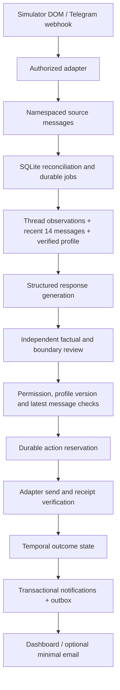

# Authorized conversation agent

This is a single-owner, single-process application with a real local browser adapter and an implemented Telegram Business Bot API adapter. Live Telegram, model and SMTP credentials were not supplied; those services are not claimed as live-verified. An OpenDate-derived unofficial Tinder executor is now implemented at the user’s explicit request; its live operation remains unverified without credentials. See TINDER.md.

## Execution and persistence

`app.py` owns the coordinator lease and starts `agent.service.worker` in FastAPI lifespan. It runs without a browser dashboard being open. This is a background task in the server process, not a separate OS worker service. Deploy one ASGI worker per database; restart supervision is provided by Compose. The lease prevents a second process from coordinating the same database. Crash restart may require the 120-second lease to expire.

Source discovery is separate from job processing. Telegram delivers authenticated webhook updates into an atomic inbox with update-ID deduplication. The synthetic browser site and enabled Tinder connections are polled; Telegram continues using webhooks. Tinder polling defaults to 180 seconds with idle backoff up to 900 seconds, inactive-history caching and additional strict freshness checks before sends. SQLite jobs are unique by thread and incoming anchor. Processing is serialized for this personal-use scale; threads have independent history, observations, drafts, permission grants and outcomes. Network model calls execute in a thread so pause/revocation requests can still be handled.

A send first refreshes the source, checks thread availability and incoming anchor, validates the profile/style version, checks global/thread/platform permissions and records a durable action before touching the platform. The simulator performs a second atomic freshness check and deduplicates action IDs in its source transaction. Telegram cannot provide the same atomic compare-and-send guarantee: an update not yet delivered by Telegram can race a send. This is a documented external consistency limit.

An interrupted/ambiguous send is quarantined. Simulator action receipts permit reconciliation without resending. Telegram lacks arbitrary history fetch/send idempotency; an ambiguous delivery blocks further sends in that thread and requires external investigation. Repeated clicks cannot reserve the same draft twice. Jobs and known pre-delivery SMTP failures have bounded retries and backoff. Ambiguous SMTP delivery is quarantined rather than risking duplicate email.

## Modes

- `supervised` (default): validated drafts require an owner approval click. Live sends still require disclosure, participant consent and an owner thread grant.
- `simulation`: autonomous sends only to the fictional simulator. No-key mode contains one narrowly scoped, explicitly labeled demonstration rule; all other unsupported input requests owner knowledge.
- `authorized_autonomy`: controls Telegram’s default automatic execution; the name does not establish Tinder platform permission. Telegram sends without per-message approval only with enabled business connection, `can_reply`, recent inbound message, owner thread grant, participant consent and recorded disclosure.

All modes respect global pause, per-thread pause/archive, revocation and uncertain previous delivery. An HTTP request already sent to an external platform cannot be recalled by a later pause.

## Memory and intelligence

The model receives the latest 14 messages, owner-verified profile facts, style/language/feedback settings, permissions and up to 24 bounded source-linked observations from this conversation. Recent observations are excluded from the extra memory block to reduce repetition. Observations preserve exact speaker text and are not asserted as verified biography; questions, suggestions, uncertainty, boundaries and cancellations are labeled. No vector database or automatic biography inference is used. Compression is unnecessary at these limits.

Generation is structured (`reply`, `no_reply`, `requires_user`), followed by a separate structured review of facts, boundaries and injection. A model cannot call tools, navigate, fetch secrets or send. A second model review is a probabilistic safeguard, not proof that a reply cannot hallucinate. A profile/style change invalidates a draft. Regenerate after adding missing personal knowledge or restoring model availability.

Outcomes are a separate chronological projection with message evidence. The local parser composes proposal details and scopes assent to a pending proposal; a later cancellation supersedes confirmation, and a changed proposal requires new assent. Optional semantic extraction (`SEMANTIC_OUTCOMES=true`) uses structured events and evidence validation. It has not been tested with a real model key. Offline rules have limited language coverage; see evaluation results.

## Source state and lifecycle

Turn states (`new_match`, `needs_reply`, `waiting`) are independent of pause/archive, availability and outcomes. Missing from a complete simulator list means `not_observed`, never confirmed unmatch. Telegram exposes new/edited/deleted messages and business connection availability; it does not expose a complete dating-match list. Media-only Telegram messages pause the thread for owner attention.

The dashboard uses current outcome state rather than historical notifications, so a cancelled date is not displayed as currently confirmed. Historical notifications remain activity evidence until retention/deletion. No calendar event is created from an unresolved weekday or implicit place.

## Security boundary

One deployment is one owner, with one configured Telegram owner ID. Separate deployments/databases/tokens are required for separate users. This is not a multi-tenant hosted SaaS. See SECURITY.md for authentication, local file access, retention and deployment boundaries.

## Tinder update

`agent/tinder.py` adapts OpenDate’s interface and pagination with read-only retries, strict identity, no message POST retry, durable receipt candidates and exact-ID read-back. Tokens stay in the environment. Match disappearance is unknown availability. Unknown source shapes/media and incomplete history block sending. No swiping, token harvesting, stealth or CAPTCHA bypass is included. See TINDER.md and THIRD_PARTY_NOTICES.md.

## Security-reviewed dispatch and account controls

Tinder automatic sending is now account-specific and on by default at connection; it does not change Telegram’s mode. Global pause and simulation remain overriding live-send stops. Final deterministic guards validate durable action/draft status, current grants, profile and source revision immediately before external dispatch. Draft reservation uses a transactional compare-and-set, so rejecting a draft during refresh prevents sending it. Live thread contents are not forwarded to a reply model before the owner consent/disclosure grant. See SECURITY_REVIEW.md for the reproduced issues and regression evidence.

Account traffic management is separate from the model: durable request/send budgets, per-thread read caches, bounded read retries, full server cooldowns, deferred receipt reconciliation and account circuit breakers. Verified sends reuse their verified source snapshot for local state instead of fetching it again. See ACCOUNT_RISK.md.
